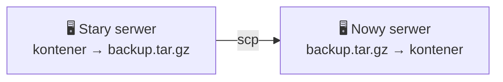

# 📦 Przenoszenie danych kontenera Docker na inny serwer

> **Do czego:** przeniesienie danych kontenera (wolumenów) na nowy serwer – kopia, przesłanie, przywrócenie.
> **Wymaga:** Docker na obu serwerach, dostęp SSH do nowego serwera.

## TL;DR

```bash
# stary serwer
docker stop upsnap
docker run --rm --volumes-from upsnap -v "$(pwd)":/backup busybox tar czvf /backup/backup.tar.gz /app/pb_data
scp ./backup.tar.gz user@192.168.1.200:~/

# nowy serwer (kontener już utworzony, zatrzymany)
docker run --rm --volumes-from upsnap -v "$(pwd)":/backup busybox sh -c "cd / && tar xzvf /backup/backup.tar.gz"
docker start upsnap
```



---

## 1. Kopia zapasowa na starym serwerze

Zatrzymaj kontener, żeby dane się nie zmieniały w trakcie kopiowania:

```bash
docker stop <kontener>
```

Spakuj katalogi z danymi (pomocniczy kontener `busybox` widzi wolumeny dzięki `--volumes-from`):

```bash
docker run --rm --volumes-from <kontener> -v "$(pwd)":/backup busybox \
  tar czvf /backup/backup.tar.gz <ścieżka-w-kontenerze> [<kolejna-ścieżka> ...]
```

| Przykład | Polecenie |
|---|---|
| UpSnap – jeden katalog | `docker run --rm --volumes-from upsnap -v "$(pwd)":/backup busybox tar czvf /backup/backup.tar.gz /app/pb_data` |
| AdGuard Home – dwa katalogi | `docker run --rm --volumes-from adguardhome -v "$(pwd)":/backup busybox tar czvf /backup/backup.tar.gz /opt/adguardhome/conf /opt/adguardhome/work` |

Archiwum `backup.tar.gz` pojawi się w bieżącym katalogu.

## 2. Przesłanie na nowy serwer

```bash
scp ./backup.tar.gz user@192.168.1.200:~/
```

- `./backup.tar.gz` – plik z poprzedniego kroku (w bieżącym katalogu),
- `user@192.168.1.200` – użytkownik i IP nowego serwera,
- `~/` – katalog domowy na nowym serwerze.

## 3. Przywrócenie na nowym serwerze

Kontener musi już istnieć (np. `docker compose up -d`, potem `docker compose stop`). W katalogu z `backup.tar.gz`:

```bash
docker run --rm --volumes-from <kontener> -v "$(pwd)":/backup busybox \
  sh -c "cd / && tar xzvf /backup/backup.tar.gz"
docker start <kontener>
```

`tar` zapisał ścieżki bez początkowego `/` (np. `app/pb_data/...`), więc rozpakowanie w `/` odtwarza je **dokładnie w tych samych miejscach** – działa dla jednego i dla wielu katalogów.

---

## Uwagi

- **Bind mount zamiast wolumenu?** Jeśli w `docker-compose.yml` masz np. `./conf:/opt/...`, wystarczy spakować katalog na hoście: `tar czvf backup.tar.gz conf work`.
- **Rozpakowanie do innej ścieżki:** `--strip-components N` pomija N pierwszych katalogów, np. `cd /app/pb_data && tar xzvf /backup/backup.tar.gz --strip-components 2` dla `app/pb_data/...`.
- `--volumes-from` podpina wszystkie wolumeny wskazanego kontenera – działa także na zatrzymanym kontenerze.

---

[← Spis treści](../README.md)
