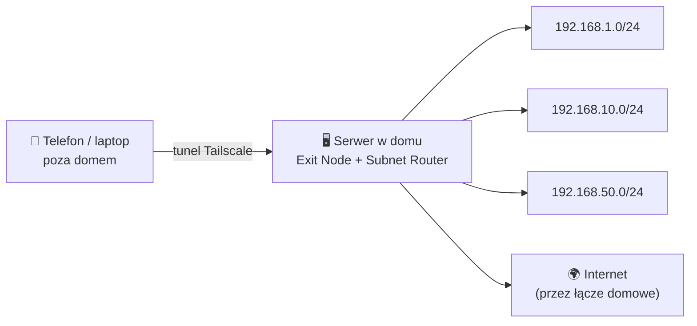

# 🌐 Tailscale – Exit Node i Subnet Router

> **Do czego:** dostęp do całej sieci domowej z dowolnego miejsca (Subnet Router) i wychodzenie do internetu przez dom (Exit Node).
> **Testowane na:** Proxmox VE 9 (Debian 13 Trixie) – działa tak samo na zwykłym Debianie/Ubuntu.

## TL;DR

```bash
curl -fsSL https://tailscale.com/install.sh | sh
printf 'net.ipv4.ip_forward = 1\nnet.ipv6.conf.all.forwarding = 1\n' | sudo tee /etc/sysctl.d/99-tailscale.conf
sudo sysctl --system
sudo tailscale up --advertise-exit-node --advertise-routes=192.168.1.0/24,192.168.10.0/24,192.168.50.0/24
# potem: zatwierdź Exit Node i trasy w panelu admina Tailscale
```



---

## 1. Instalacja

```bash
curl -fsSL https://tailscale.com/install.sh | sh
```

## 2. Przekazywanie pakietów (IP forwarding)

```bash
cat <<EOF | sudo tee /etc/sysctl.d/99-tailscale.conf
net.ipv4.ip_forward = 1
net.ipv6.conf.all.forwarding = 1
EOF
sudo sysctl --system
```

Sprawdzenie – oba polecenia powinny zwrócić `= 1`:

```bash
sysctl net.ipv4.ip_forward
sysctl net.ipv6.conf.all.forwarding
```

## 3. Logowanie i włączenie Exit Node + Subnet Router

```bash
sudo tailscale up \
  --advertise-exit-node \
  --advertise-routes=192.168.1.0/24,192.168.10.0/24,192.168.50.0/24
```

Przy pierwszym uruchomieniu pojawi się link do zalogowania. Adresy sieci dostosuj do swojej konfiguracji.

| Parametr | Znaczenie |
|---|---|
| `--advertise-exit-node` | serwer może być bramą do internetu dla innych urządzeń |
| `--advertise-routes` | sieci lokalne udostępniane w Tailscale |

Zmiana ustawień później (bez powtarzania wszystkich flag): `sudo tailscale set --advertise-routes=...`

## 4. Zatwierdzenie w panelu administracyjnym

W [panelu Tailscale](https://login.tailscale.com/admin/machines) → maszyna → **Edit route settings** zaznacz:

- ✅ **Use as exit node**
- ✅ udostępniane **subnet routes**

Do zatwierdzenia funkcje nie są widoczne dla innych urządzeń.

## 5. Po stronie klienta

| Klient | Jak |
|---|---|
| Windows / macOS / telefon | menu Tailscale → **Exit node** → wybierz serwer |
| Linux – dostęp do sieci domowej | `sudo tailscale up --accept-routes` |
| Linux – ruch przez dom | `sudo tailscale set --exit-node=<IP_lub_nazwa_serwera>` |

---

## Opcjonalnie: wydajność UDP (zalecane przez Tailscale)

```bash
NETDEV=$(ip -o route get 8.8.8.8 | cut -f 5 -d " ")
sudo ethtool -K "$NETDEV" rx-udp-gro-forwarding on rx-gro-list off
```

Ustawienie znika po restarcie – żeby było trwałe, dodaj je np. do skryptu w `/etc/networkd-dispatcher/routable.d/`.

## Źródła

- [Tailscale – Exit nodes](https://tailscale.com/kb/1103/exit-nodes)
- [Tailscale – Subnet routers](https://tailscale.com/kb/1019/subnets)

---

[← Spis treści](../README.md)
