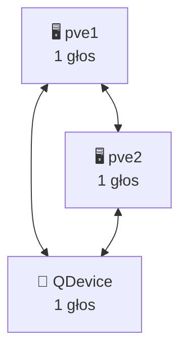

# ⚖️ Proxmox QDevice – klaster dwuwęzłowy z trzecim głosem

> **Do czego:** w klastrze z 2 węzłów awaria jednego zabiera kworum (1 z 2 głosów). QDevice to lekki trzeci „głos” na dowolnym małym Linuksie (np. Raspberry Pi), dzięki któremu pozostały węzeł dalej działa.

## TL;DR

```bash
# oba węzły Proxmox
apt update && apt install corosync-qdevice
# serwer QDevice (zwykły Debian/Raspberry Pi)
apt update && apt install corosync-qnetd
# jeden z węzłów Proxmox
pvecm qdevice setup 192.168.1.100
pvecm status
```



3 głosy, kworum = 2 → po awarii jednego węzła zostają 2 głosy i klaster działa dalej.

---

## 1. Klaster (jeśli jeszcze go nie ma)

```bash
pvecm create <nazwa-klastra>     # na pierwszym węźle
pvecm add <IP-pierwszego-węzła>  # na drugim węźle
```

## 2. `corosync-qdevice` na obu węzłach Proxmox

```bash
apt update
apt install corosync-qdevice
```

## 3. `corosync-qnetd` na serwerze QDevice

```bash
apt update
apt install corosync-qnetd
systemctl enable --now corosync-qnetd
```

## 4. Dodanie QDevice do klastra

Na jednym z węzłów Proxmox:

```bash
pvecm qdevice setup 192.168.1.100
```

`192.168.1.100` to adres serwera QDevice. Polecenie łączy się z nim przez **SSH jako root** – na czas konfiguracji musi być dozwolone logowanie roota (potem można je wyłączyć).

## 5. Weryfikacja

```bash
pvecm status
```

W sekcji *Votequorum information* powinny być **3** głosy (`Expected votes: 3`), a na liście członków wpis `Qdevice`.

---

## Uwagi

- QDevice **nie** uruchamia maszyn wirtualnych – tylko głosuje. Wystarczy mu Raspberry Pi albo mała VM… ale **poza** klastrem, którego dotyczy.
- QDevice ma sens przy **parzystej** liczbie węzłów (najczęściej 2).

## Źródła

- [WunderTech – How to create a 2-node cluster in Proxmox](https://www.wundertech.net/how-to-create-a-2-node-cluster-in-proxmox/)
- [Proxmox VE – Corosync External Vote Support](https://pve.proxmox.com/wiki/Cluster_Manager#_corosync_external_vote_support)

---

[← Spis treści](../README.md)
