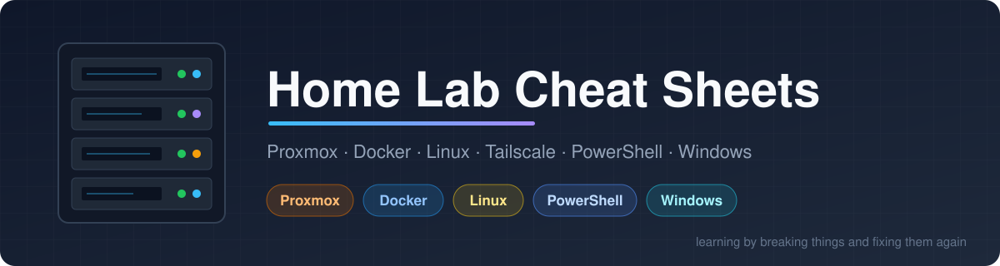
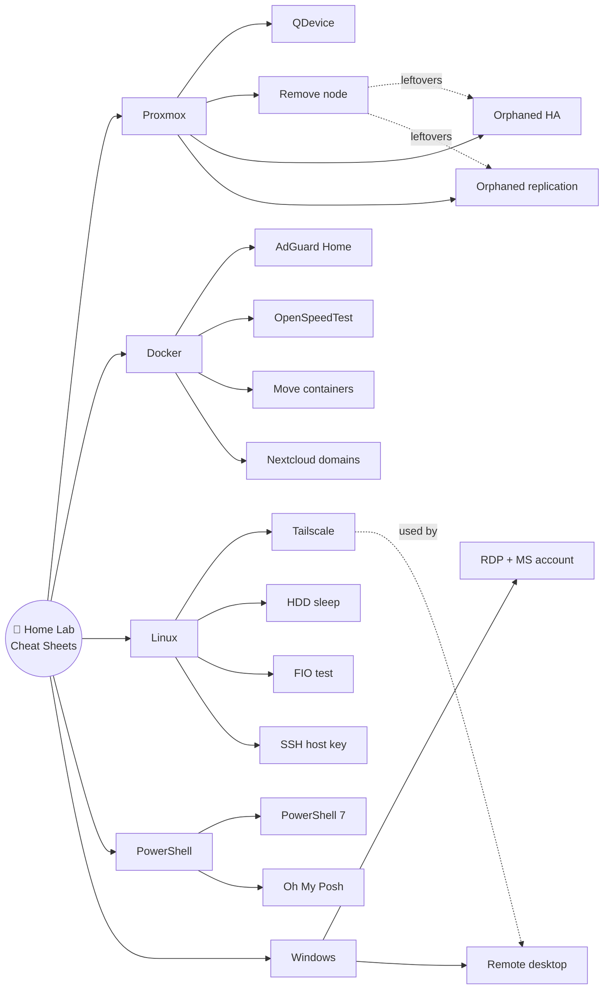

<p align="center">
  
</p>

<p align="center">
  
  
  
  
</p>

# 🧪 Home Lab Cheat Sheets

Hi! I'm Kania – a young IT enthusiast experimenting with servers, networking and automation in my personal home lab.
This repository is my digital lab notebook: short, copy-paste-ready cheat sheets for things I set up, broke and fixed.

<p align="center">
  
</p>

> 💡 The cheat sheets are written in **Polish**. Every one of them starts with a **TL;DR** block – the commands you
> usually need – followed by step-by-step instructions, notes and sources.

---

## 📚 Contents

###  Proxmox

| Cheat sheet | What it solves |
|---|---|
| [QDevice – 2-node cluster](Proxmox/qdevice-2-node-cluster.md) | a third quorum vote so a 2-node cluster survives losing one node |
| [Removing a node from the cluster](Proxmox/removing-node-from-cluster.md) | `pvecm delnode` and the manual `corosync.conf` way |
| [Orphaned HA state](Proxmox/removing-orphaned-ha-state.md) | a deleted node still shows up in `ha-manager status` |
| [Orphaned replication jobs](Proxmox/removing-orphaned-replication-jobs.md) | replication jobs pointing to a node that no longer exists |

###  Docker

| Cheat sheet | What it solves |
|---|---|
| [AdGuard Home](Docker/adguard-home.md) | network-wide ad blocking DNS, DoH upstreams, blocklists |
| [OpenSpeedTest](Docker/openspeedtest.md) | LAN / Wi-Fi / VPN speed test in the browser |
| [Moving containers between servers](Docker/moving-containers-between-servers.md) | back up, copy and restore container data |
| [Nextcloud `trusted_domains`](Docker/nextcloud-trusted-domains.md) | the "Access through untrusted domain" error |

###  Linux

| Cheat sheet | What it solves |
|---|---|
| [Tailscale – Exit Node & Subnet Router](Linux/tailscale-exit-node-subnet-router.md) | reach the whole home network from anywhere |
| [HDD sleep with `hdparm`](Linux/hdd-sleep-hdparm.md) | check disk state, spin down now or after idle time |
| [FIO – sequential write test](Linux/fio-sequential-write-test.md) | measure disk throughput, IOPS and latency |
| [SSH – remove an old host key](Linux/ssh-remove-old-host-key.md) | "REMOTE HOST IDENTIFICATION HAS CHANGED!" |

###  PowerShell

| Cheat sheet | What it solves |
|---|---|
| [Install PowerShell 7 with winget](PowerShell/install-powershell-winget.md) | the current PowerShell next to Windows PowerShell 5.1 |
| [Oh My Posh](PowerShell/oh-my-posh.md) | a nice prompt with Git status, Nerd Font setup |

### 🪟 Windows

| Cheat sheet | What it solves |
|---|---|
| [RDP with a Microsoft account](Windows/rdp-microsoft-account.md) | Remote Desktop rejecting a correct Microsoft account password |
| [Remote desktop from anywhere](Windows/remote-desktop-tailscale-wol.md) | Tailscale + Wake-on-LAN (UpSnap) + RDP |

---

## 🗺️ Repository map



```text
home-lab-cheat-sheets/
├── Docker/
│   ├── adguard-home.md
│   ├── moving-containers-between-servers.md
│   ├── nextcloud-trusted-domains.md
│   └── openspeedtest.md
├── Linux/
│   ├── fio-sequential-write-test.md
│   ├── hdd-sleep-hdparm.md
│   ├── ssh-remove-old-host-key.md
│   └── tailscale-exit-node-subnet-router.md
├── PowerShell/
│   ├── install-powershell-winget.md
│   └── oh-my-posh.md
├── Proxmox/
│   ├── qdevice-2-node-cluster.md
│   ├── removing-node-from-cluster.md
│   ├── removing-orphaned-ha-state.md
│   └── removing-orphaned-replication-jobs.md
├── Windows/
│   ├── rdp-microsoft-account.md
│   └── remote-desktop-tailscale-wol.md
├── media/
│   ├── banner.svg
│   └── me.jpg
├── LICENSE
└── README.md
```

---

## 📌 Purpose

This is not a polished, production-ready project – it's a **learning sandbox and documentation hub**.
If something here helps you – awesome! If it breaks – even better. That's how we learn 🚀

Addresses such as `192.168.1.200` or `example.com` are examples – replace them with your own.

## 📜 License & sources

Most of the content is written by me; some parts are inspired by or based on public sources, credited in the
cheat sheets themselves and here:

- [Christian Lempa's Cheat Sheets](https://github.com/ChristianLempa/cheat-sheets) – MIT License
- [WunderTech](https://www.wundertech.net/) – Proxmox guides, used with attribution
- Official documentation: [Proxmox VE](https://pve.proxmox.com/wiki/Main_Page), [Tailscale](https://tailscale.com/kb), [AdGuard Home](https://github.com/AdguardTeam/AdGuardHome), [Oh My Posh](https://ohmyposh.dev/)

All original content is available under the **MIT License** – see [LICENSE](LICENSE).

## 🤝 Get in touch

Got feedback, questions, or want to nerd out together? Open an issue or reach out!

---

<p align="center"><i>🧠 “Learning by breaking things and fixing them again.”</i></p>
