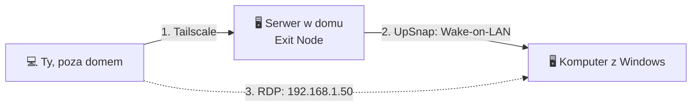

# 🏠 Pulpit zdalny spoza domu – Tailscale + Wake-on-LAN + RDP

> **Do czego:** połączenie z domowym komputerem z dowolnego miejsca – nawet gdy jest wyłączony.
> **Składniki:** Tailscale (Exit Node / Subnet Router), UpSnap (Wake-on-LAN w przeglądarce), Pulpit zdalny Windows.

---

## 1. Połącz się z siecią domową przez Tailscale

Na swoim urządzeniu włącz Tailscale i wybierz serwer domowy jako **Exit Node** (albo korzystaj z udostępnionej podsieci).
Konfiguracja serwera: [tailscale-exit-node-subnet-router.md](../Linux/tailscale-exit-node-subnet-router.md).

## 2. Włącz komputer (Wake-on-LAN)

Otwórz panel UpSnap, np. `https://upsnap.example.lan`, i kliknij **Wake** przy komputerze.
Wake-on-LAN musi być włączony w BIOS/UEFI i we właściwościach karty sieciowej w Windows.

## 3. Połącz się przez RDP

Uruchom **Podłączanie pulpitu zdalnego** (`mstsc`) i wpisz:

| Pole | Wartość |
|---|---|
| Komputer | lokalny adres IP komputera, np. `192.168.1.50` |
| Użytkownik | adres e-mail konta Microsoft |
| Hasło | hasło do konta Microsoft |

Odrzuca hasło? → [rdp-microsoft-account.md](rdp-microsoft-account.md).

---

## Uwagi

- Komputer docelowy powinien mieć **stały adres IP** (rezerwacja DHCP w routerze).
- Nie wystawiaj portu RDP (3389) do internetu – Tailscale wystarcza i jest bezpieczniejszy.

---

[← Spis treści](../README.md)
